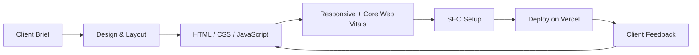
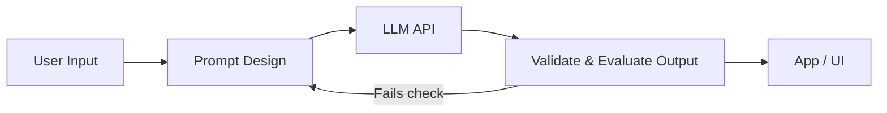

<!--
  SETUP: replace every YOUR_USERNAME with your GitHub username.
  Search for "TODO" to fill every placeholder with real info.
  Needs assets/header.svg, assets/divider.svg, assets/footer.svg in the same repo.
-->

<div align="center">




<br/>

[](https://rajasalman-portfolio.vercel.app/)
[](https://linkedin.com/in/raja-salman-73467839a)
[](mailto:rajasalman.dev@gmail.com)


<br/><br/>

[](#-about-me)
[](#-skills-and-proof)
[](#-python-numpy--pandas)
[](#-web-development)
[](#-generative-ai)
[](#-featured-projects)
[](#-learning-roadmap)
[](#-lets-connect)

</div>


## 👋 About Me

<div align="center">

</div>

I'm building toward **Java backend engineering and cloud architecture** (Spring Boot, Spring AI, AWS). Alongside university I:

- 🌐 ship **production websites for real clients**
- 🧹 clean and validate **real business data** (Excel → structured, deduplicated, verified)
- 🤖 compete in **AI hackathons** and build with LLM APIs
- ☁️ study **system design, Linux and cloud deployment**

> [!NOTE]
> **My rule:** Fundamentals first, then ship, then repeat.

| | |
|---|---|
| 🎯 **Target role** | Java Backend Developer → Cloud Architect |
| 🏆 **Hackathons** | Generative AI Hackathon · Aspire Pakistan / Pak Angels AI Hackathon · TODO add third hackathon name |
| 🌍 **Location** | Rawalpindi, Pakistan |
| 🤝 **Open to** | Internships · Freelance web projects · Collaboration |


## 🧭 Skills and Proof

<div align="center">

</div>

| Skill | Level | Proof / what I've done |
|---|---|---|
| ☕ **Java (OOP)** |  | JavaFX Student Learning Management System |
| ⚙️ **C++** |  | Inventory system with file handling & data structures |
| 🗄️ **SQL / MySQL / PostgreSQL** |  | Cricket League DB, 3NF normalization, ER diagrams |
| 🌐 **HTML / CSS / JavaScript** |  | Production client sites (Oasis Tree, Telnet Marketing) |
| 🐍 **Python** |  | Completed course, building data and AI projects |
| 🔢 **NumPy / Pandas** |  | Completed course, data cleaning and analysis |
| 🟩 **Node.js** |  | TODO add one project or exercise using it |
| 🤖 **Generative AI / LLM APIs** |  | Hackathons + LLM-based projects below |
| ☁️ **AWS / Linux / Deployment** |  | Completed courses, deploying to Vercel and cloud |
| 🔁 **n8n automation** |  | TODO add one workflow you built |
| 📱 **Flutter / Kotlin (Android)** |  | Fundamentals only |
| 🚀 **Spring Boot / Spring AI** |  | Main target stack |

**Languages:**     

**Web & Backend:**    

**Data & AI:**   

**Cloud & Tools:**     

**Mobile (basics):**  


## 🐍 Python, NumPy & Pandas

<div align="center">

</div>

I use these to clean and validate data, the same problem I solve for a B2B data marketplace (verifying records, removing duplicates, fixing missing fields).

<details>
<summary><b>📘 What I've learned (click to expand)</b></summary>

&nbsp;

**Python**
- Data types, functions, OOP, file handling, error handling
- Virtual environments, `pip`, project structure

**NumPy**
- Arrays, indexing and slicing, broadcasting
- Vectorized operations (faster than loops)
- Basic statistics and linear algebra

**Pandas**
- `DataFrame` / `Series`, filtering, `groupby`, merging
- Cleaning: missing values, duplicates, type fixes
- Reading and writing CSV and Excel

</details>

<details>
<summary><b>🧪 Example: cleaning a lead list with Pandas</b></summary>

&nbsp;

```python
import pandas as pd

df = pd.read_excel("leads_raw.xlsx")

df.columns = df.columns.str.strip().str.lower().str.replace(" ", "_")
df["email"] = df["email"].str.strip().str.lower()

df = df.drop_duplicates(subset="email")
df = df.dropna(subset=["email", "company"])

valid = df["email"].str.match(r"^[^@\s]+@[^@\s]+\.[^@\s]+$")
df_clean = df[valid]

print(f"Kept {len(df_clean)} of {len(df)} rows")
df_clean.to_csv("leads_clean.csv", index=False)
```

</details>

<details>
<summary><b>🔢 Example: why NumPy beats loops</b></summary>

&nbsp;

```python
import numpy as np

prices = np.array([120, 80, 150, 200])
tax = 0.17

with_tax = prices * (1 + tax)   # one vectorized operation, no loop
print(with_tax.round(2))
```

</details>


## 🌐 Web Development

<div align="center">

</div>

I build websites and deliver them to real clients.



<details>
<summary><b>🧱 Frontend & JavaScript</b></summary>

&nbsp;

- HTML5 semantic structure, CSS3 layouts (Flexbox, Grid), responsive design
- JavaScript ES6+: modules, async/await, fetch, DOM events
- Integrations: EmailJS contact forms, WhatsApp / phone / LinkedIn links

</details>

<details>
<summary><b>🟩 Node.js (backend basics)</b></summary>

&nbsp;

- Running JavaScript on the server, `npm`, modules
- Building simple REST endpoints
- Plan: use it as a stepping stone to Java Spring Boot APIs

```javascript
import http from "node:http";

http.createServer((req, res) => {
  if (req.url === "/health") {
    res.writeHead(200, { "Content-Type": "application/json" });
    return res.end(JSON.stringify({ status: "ok" }));
  }
  res.writeHead(404).end();
}).listen(3000);
```

</details>

<details>
<summary><b>📈 SEO & Performance</b></summary>

&nbsp;

- On-page SEO, off-page SEO, backlinks, PageRank basics
- Core Web Vitals (LCP, CLS, INP): image sizing, lazy loading, minimal blocking scripts

</details>


## 🤖 Generative AI

<div align="center">

</div>



<details>
<summary><b>🧠 What I focus on</b></summary>

&nbsp;

- Prompt design and structured outputs
- Calling LLM APIs from Python
- Evaluating output quality instead of trusting it blindly
- Automating workflows with n8n
- Next step: **Spring AI** to bring LLMs into Java backends

</details>

<details>
<summary><b>🏆 Hackathons</b></summary>

&nbsp;

| Event | What I did |
|---|---|
| Aspire Pakistan / Pak Angels AI Hackathon | Applied AI to real-world problems in a cross-functional team, pitched under a tight deadline |
| Generative AI Hackathon | TODO: one line on your project and your role |
| TODO third hackathon | TODO: one line on your project and your role |

</details>


## 🚀 Featured Projects

<div align="center">

</div>

<table>
<tr>
<td width="50%" valign="top">

### 🧠 Human Touch Quality Layer
Streamlit app that scores communications on empathy, naturalness, personalization, context-awareness and brand voice using an LLM API.

  

[](https://github.com/YOUR_USERNAME/TODO_REPO)

</td>
<td width="50%" valign="top">

### 🏆 TODO: Hackathon Project
One line: the problem, how you solved it, the result.

 

[](https://github.com/YOUR_USERNAME/TODO_REPO)

</td>
</tr>
<tr>
<td width="50%" valign="top">

### 🌳 Oasis Tree Lead Marketplace
Production single-page site for a B2B lead data marketplace with EmailJS contact form and WhatsApp, phone and LinkedIn integrations.

  

[](https://TODO_LIVE_URL)

</td>
<td width="50%" valign="top">

### 🏏 Cricket League Management System
Relational database in 3NF with ER diagrams, SQL queries and full documentation.

 

[](https://github.com/YOUR_USERNAME/TODO_REPO)

</td>
</tr>
<tr>
<td width="50%" valign="top">

### 🎓 Student Learning Management System
JavaFX desktop app for student data, enrollments and academic records.

  

[](https://github.com/YOUR_USERNAME/TODO_REPO)

</td>
<td width="50%" valign="top">

### 📦 Inventory Management System
C++ system for products and sales with file-based persistence.

 

[](https://github.com/YOUR_USERNAME/TODO_REPO)

</td>
</tr>
</table>


## 📚 Learning Roadmap

<div align="center">

</div>

- [x] Java OOP, C++, SQL fundamentals
- [x] HTML, CSS, JavaScript and client website delivery
- [x] Python, NumPy, Pandas courses
- [x] AI hackathons
- [ ] Spring Boot REST API with PostgreSQL
- [ ] Spring AI integration project
- [ ] AWS: deploy a backend (EC2 / RDS / S3)
- [ ] Docker and CI/CD with GitHub Actions
- [ ] System design: caching, queues, load balancing
- [ ] Data structures and algorithms practice

> [!TIP]
> I tick one box at a time and ship something with each one.

### 🎯 Current Focus


## 🌐 Let's Connect

<div align="center">


<br/>

[](https://rajasalman-portfolio.vercel.app/)
[](https://linkedin.com/in/raja-salman-73467839a)
[](mailto:rajasalman.dev@gmail.com)

<br/>


</div>
