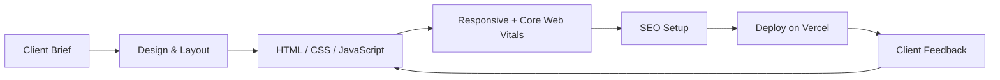
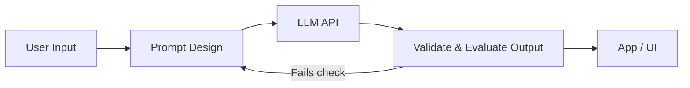

<!--
  SETUP: replace every YOUR_USERNAME with your GitHub username.
  Search for "TODO" to find every placeholder you must fill with real info.
-->
<svg xmlns="http://www.w3.org/2000/svg" width="1000" height="280" viewBox="0 0 1000 280" role="img" aria-label="Raja Salman - Java Backend, Cloud, Generative AI" xmlns:c2pa="http://c2pa.org/manifest">
<defs>
  <linearGradient id="bg" x1="0" y1="0" x2="1" y2="1">
    <stop offset="0" stop-color="#0d1117"/>
    <stop offset="0.5" stop-color="#1b1146"/>
    <stop offset="1" stop-color="#062f35"/>
  </linearGradient>
  <linearGradient id="name" gradientUnits="userSpaceOnUse" x1="250" y1="0" x2="750" y2="0" spreadMethod="reflect">
    <stop offset="0" stop-color="#a78bfa"/>
    <stop offset="0.5" stop-color="#38bdf8"/>
    <stop offset="1" stop-color="#F7C948"/>
    <animateTransform attributeName="gradientTransform" type="translate" from="-500 0" to="500 0" dur="6s" repeatCount="indefinite"/>
  </linearGradient>
  <linearGradient id="w1" x1="0" y1="0" x2="0" y2="1">
    <stop offset="0" stop-color="#7c3aed" stop-opacity=".55"/>
    <stop offset="1" stop-color="#7c3aed" stop-opacity=".05"/>
  </linearGradient>
  <linearGradient id="w2" x1="0" y1="0" x2="0" y2="1">
    <stop offset="0" stop-color="#14b8a6" stop-opacity=".55"/>
    <stop offset="1" stop-color="#14b8a6" stop-opacity=".05"/>
  </linearGradient>
  <filter id="blur" x="-50%" y="-50%" width="200%" height="200%"><feGaussianBlur stdDeviation="40"/></filter>
  <filter id="glow" x="-20%" y="-50%" width="140%" height="200%"><feGaussianBlur stdDeviation="8"/></filter>
</defs>
<style>
  .mono{font-family:'Fira Code','SFMono-Regular',Consolas,'Courier New',monospace}
  .sans{font-family:'Segoe UI',Helvetica,Arial,sans-serif}
  .star{animation:twinkle 3s ease-in-out infinite}
  @keyframes twinkle{0%,100%{opacity:.1}50%{opacity:.95}}
  .rise{opacity:0;animation:rise 8s linear infinite}
  @keyframes rise{0%{transform:translateY(0);opacity:0}10%{opacity:.8}100%{transform:translateY(-250px);opacity:0}}
  .wave1{animation:wave 14s linear infinite}
  .wave2{animation:wave 22s linear infinite reverse}
  @keyframes wave{from{transform:translateX(0)}to{transform:translateX(-1000px)}}
  .orb1{animation:orb1 12s ease-in-out infinite alternate}
  .orb2{animation:orb2 15s ease-in-out infinite alternate}
  @keyframes orb1{from{transform:translate(0,0)}to{transform:translate(180px,40px)}}
  @keyframes orb2{from{transform:translate(0,0)}to{transform:translate(-200px,-30px)}}
  .intro{animation:intro 1.2s ease-out backwards}
  @keyframes intro{from{opacity:0;transform:translateY(22px)}to{opacity:1;transform:translateY(0)}}
  .glowtxt{animation:pulse 3s ease-in-out infinite}
  @keyframes pulse{0%,100%{opacity:.25}50%{opacity:.7}}
  .line{transform-box:fill-box;transform-origin:center;animation:grow 1.4s .6s ease-out backwards}
  @keyframes grow{from{transform:scaleX(0)}to{transform:scaleX(1)}}
  .tag{animation:cycle 12s infinite}
  .t2,.t3{opacity:0}
  @keyframes cycle{0%{opacity:0;transform:translateY(10px)}4%,22%{opacity:1;transform:translateY(0)}26%,100%{opacity:0;transform:translateY(-10px)}}
  .chip{opacity:1}
  .chipin{animation:float 4s ease-in-out infinite}
  @keyframes float{0%,100%{transform:translateY(0)}50%{transform:translateY(-9px)}}
  .cursor{animation:blink 1s steps(1) infinite}
  @keyframes blink{50%{opacity:0}}
</style>

<rect width="1000" height="280" fill="url(#bg)"/>
<circle class="orb1" cx="220" cy="90" r="130" fill="#7c3aed" opacity=".45" filter="url(#blur)"/>
<circle class="orb2" cx="780" cy="130" r="130" fill="#14b8a6" opacity=".4" filter="url(#blur)"/>

<circle cx="341" cy="48" r="1.8" fill="#fff" class="star" style="animation-duration:2.68s;animation-delay:3.25s"/>
<circle cx="558" cy="34" r="1.3" fill="#fff" class="star" style="animation-duration:4.77s;animation-delay:2.91s"/>
<circle cx="229" cy="19" r="0.8" fill="#fff" class="star" style="animation-duration:2.67s;animation-delay:2.17s"/>
<circle cx="102" cy="151" r="1.8" fill="#fff" class="star" style="animation-duration:3.91s;animation-delay:0.3s"/>
<circle cx="980" cy="67" r="0.8" fill="#fff" class="star" style="animation-duration:3.49s;animation-delay:2.89s"/>
<circle cx="236" cy="21" r="1" fill="#fff" class="star" style="animation-duration:2.86s;animation-delay:1.45s"/>
<circle cx="130" cy="156" r="1.3" fill="#fff" class="star" style="animation-duration:4.21s;animation-delay:2.8s"/>
<circle cx="115" cy="158" r="1" fill="#fff" class="star" style="animation-duration:3.87s;animation-delay:1.86s"/>
<circle cx="74" cy="154" r="0.8" fill="#fff" class="star" style="animation-duration:3.74s;animation-delay:3.1s"/>
<circle cx="554" cy="119" r="1.3" fill="#fff" class="star" style="animation-duration:4.81s;animation-delay:2.33s"/>
<circle cx="380" cy="86" r="1" fill="#fff" class="star" style="animation-duration:4.25s;animation-delay:3.97s"/>
<circle cx="259" cy="30" r="1.3" fill="#fff" class="star" style="animation-duration:4.69s;animation-delay:2.63s"/>
<circle cx="756" cy="124" r="1.3" fill="#fff" class="star" style="animation-duration:2.68s;animation-delay:3.04s"/>
<circle cx="534" cy="117" r="1" fill="#fff" class="star" style="animation-duration:2.88s;animation-delay:3.79s"/>
<circle cx="510" cy="117" r="0.8" fill="#fff" class="star" style="animation-duration:2.69s;animation-delay:4.81s"/>
<circle cx="581" cy="156" r="1.3" fill="#fff" class="star" style="animation-duration:3.38s;animation-delay:1.7s"/>
<circle cx="518" cy="158" r="1.8" fill="#fff" class="star" style="animation-duration:2.73s;animation-delay:0.34s"/>
<circle cx="286" cy="131" r="0.8" fill="#fff" class="star" style="animation-duration:4.25s;animation-delay:0.3s"/>
<circle cx="672" cy="157" r="1.8" fill="#fff" class="star" style="animation-duration:3.46s;animation-delay:1.42s"/>
<circle cx="694" cy="98" r="0.8" fill="#fff" class="star" style="animation-duration:3.39s;animation-delay:4.7s"/>
<circle cx="635" cy="39" r="1.8" fill="#fff" class="star" style="animation-duration:4.42s;animation-delay:0.29s"/>
<circle cx="142" cy="199" r="1" fill="#fff" class="star" style="animation-duration:4.79s;animation-delay:1.99s"/>
<circle cx="518" cy="30" r="1" fill="#fff" class="star" style="animation-duration:3.87s;animation-delay:2.25s"/>
<circle cx="914" cy="45" r="1.8" fill="#fff" class="star" style="animation-duration:3.2s;animation-delay:4.32s"/>
<circle cx="435" cy="101" r="1.8" fill="#fff" class="star" style="animation-duration:2.88s;animation-delay:4.79s"/>
<circle cx="190" cy="48" r="1" fill="#fff" class="star" style="animation-duration:2.53s;animation-delay:3.29s"/>
<circle cx="861" cy="160" r="1" fill="#fff" class="star" style="animation-duration:2.51s;animation-delay:1.31s"/>
<circle cx="439" cy="146" r="1.3" fill="#fff" class="star" style="animation-duration:3.3s;animation-delay:3.05s"/>
<circle cx="138" cy="186" r="0.8" fill="#fff" class="star" style="animation-duration:4.68s;animation-delay:2.28s"/>
<circle cx="984" cy="184" r="1.8" fill="#fff" class="star" style="animation-duration:3.49s;animation-delay:1.99s"/>
<circle cx="503" cy="172" r="1.8" fill="#fff" class="star" style="animation-duration:2.67s;animation-delay:0.31s"/>
<circle cx="223" cy="122" r="1" fill="#fff" class="star" style="animation-duration:4.0s;animation-delay:0.55s"/>
<circle cx="114" cy="10" r="1" fill="#fff" class="star" style="animation-duration:4.87s;animation-delay:2.68s"/>
<circle cx="638" cy="16" r="0.8" fill="#fff" class="star" style="animation-duration:4.04s;animation-delay:4.37s"/>
<circle cx="162" cy="172" r="1.3" fill="#fff" class="star" style="animation-duration:4.01s;animation-delay:4.78s"/>
<circle cx="495" cy="41" r="0.8" fill="#fff" class="star" style="animation-duration:4.98s;animation-delay:4.24s"/>
<circle cx="487" cy="132" r="1.8" fill="#fff" class="star" style="animation-duration:2.86s;animation-delay:1.56s"/>
<circle cx="777" cy="97" r="1.3" fill="#fff" class="star" style="animation-duration:4.23s;animation-delay:2.39s"/>
<circle cx="548" cy="270" r="2" fill="#F7C948" class="rise" style="animation-duration:10.76s;animation-delay:1.64s"/>
<circle cx="170" cy="270" r="4" fill="#F7C948" class="rise" style="animation-duration:6.14s;animation-delay:4.35s"/>
<circle cx="678" cy="270" r="2" fill="#F7C948" class="rise" style="animation-duration:7.31s;animation-delay:5.57s"/>
<circle cx="950" cy="270" r="2" fill="#F7C948" class="rise" style="animation-duration:7.11s;animation-delay:2.85s"/>
<circle cx="671" cy="270" r="2" fill="#14b8a6" class="rise" style="animation-duration:9.94s;animation-delay:4.91s"/>
<circle cx="845" cy="270" r="2" fill="#14b8a6" class="rise" style="animation-duration:9.7s;animation-delay:6.55s"/>
<circle cx="224" cy="270" r="4" fill="#7c3aed" class="rise" style="animation-duration:9.66s;animation-delay:3.94s"/>
<circle cx="829" cy="270" r="3" fill="#F7C948" class="rise" style="animation-duration:6.97s;animation-delay:3.78s"/>
<circle cx="477" cy="270" r="4" fill="#F7C948" class="rise" style="animation-duration:10.78s;animation-delay:7.9s"/>
<circle cx="102" cy="270" r="2" fill="#F7C948" class="rise" style="animation-duration:8.35s;animation-delay:0.82s"/>
<circle cx="229" cy="270" r="3" fill="#7c3aed" class="rise" style="animation-duration:10.5s;animation-delay:4.99s"/>
<circle cx="510" cy="270" r="4" fill="#7c3aed" class="rise" style="animation-duration:9.22s;animation-delay:2.75s"/>
<circle cx="951" cy="270" r="3" fill="#38bdf8" class="rise" style="animation-duration:9.75s;animation-delay:6.26s"/>
<circle cx="930" cy="270" r="2" fill="#7c3aed" class="rise" style="animation-duration:9.18s;animation-delay:3.47s"/>

<g class="wave2"><path d="M0 222 q250.0 -26 500 0 t500 0 t500 0 t500 0 t500 0 L2500 280 L0 280 Z" fill="url(#w2)"/></g>
<g class="wave1"><path d="M0 238 q125.0 -18 250 0 t250 0 t250 0 t250 0 t250 0 t250 0 t250 0 t250 0 t250 0 t250 0 L2500 280 L0 280 Z" fill="url(#w1)"/></g>

<g class="chip" style="animation-delay:0s" transform="translate(45,70)">
  <g class="chipin" style="animation-delay:0s">
  <rect width="58" height="28" rx="14" fill="#0d1117" fill-opacity=".7" stroke="#F7C948" stroke-width="1.4"/>
  <text x="29.0" y="19" text-anchor="middle" class="mono" font-size="13" fill="#F7C948">Java</text>
  </g></g>
<g class="chip" style="animation-delay:1.2s" transform="translate(95,125)">
  <g class="chipin" style="animation-delay:1.2s">
  <rect width="76" height="28" rx="14" fill="#0d1117" fill-opacity=".7" stroke="#38bdf8" stroke-width="1.4"/>
  <text x="38.0" y="19" text-anchor="middle" class="mono" font-size="13" fill="#38bdf8">Python</text>
  </g></g>
<g class="chip" style="animation-delay:2.4s" transform="translate(40,180)">
  <g class="chipin" style="animation-delay:2.4s">
  <rect width="49" height="28" rx="14" fill="#0d1117" fill-opacity=".7" stroke="#fb923c" stroke-width="1.4"/>
  <text x="24.5" y="19" text-anchor="middle" class="mono" font-size="13" fill="#fb923c">AWS</text>
  </g></g>
<g class="chip" style="animation-delay:0.6s" transform="translate(835,65)">
  <g class="chipin" style="animation-delay:0.6s">
  <rect width="121" height="28" rx="14" fill="#0d1117" fill-opacity=".7" stroke="#4ade80" stroke-width="1.4"/>
  <text x="60.5" y="19" text-anchor="middle" class="mono" font-size="13" fill="#4ade80">Spring Boot</text>
  </g></g>
<g class="chip" style="animation-delay:1.8s" transform="translate(870,122)">
  <g class="chipin" style="animation-delay:1.8s">
  <rect width="67" height="28" rx="14" fill="#0d1117" fill-opacity=".7" stroke="#a78bfa" stroke-width="1.4"/>
  <text x="33.5" y="19" text-anchor="middle" class="mono" font-size="13" fill="#a78bfa">NumPy</text>
  </g></g>
<g class="chip" style="animation-delay:3.0s" transform="translate(850,178)">
  <g class="chipin" style="animation-delay:3.0s">
  <rect width="76" height="28" rx="14" fill="#0d1117" fill-opacity=".7" stroke="#f472b6" stroke-width="1.4"/>
  <text x="38.0" y="19" text-anchor="middle" class="mono" font-size="13" fill="#f472b6">Gen AI</text>
  </g></g>

<g class="intro">
  <text x="500" y="118" text-anchor="middle" class="sans" font-size="66" font-weight="800" letter-spacing="6" fill="url(#name)" filter="url(#glow)"><tspan class="glowtxt">RAJA SALMAN</tspan></text>
  <text x="500" y="118" text-anchor="middle" class="sans" font-size="66" font-weight="800" letter-spacing="6" fill="url(#name)">RAJA SALMAN</text>
</g>
<rect class="line" x="360" y="136" width="280" height="3" rx="1.5" fill="url(#name)"/>

<g class="mono" font-size="22" text-anchor="middle" fill="#F7C948">
  <text class="tag" x="500" y="176" style="animation-delay:0s">&gt; Java Backend Developer</text>
  <text class="tag t2" x="500" y="176" style="animation-delay:4s" fill="#38bdf8">&gt; Cloud &amp; AWS Learner</text>
  <text class="tag t3" x="500" y="176" style="animation-delay:8s" fill="#f472b6">&gt; Generative AI Builder</text>
</g>
<text x="500" y="204" text-anchor="middle" class="mono intro" font-size="13" fill="#8b949e" style="animation-delay:1.2s">BSCS @ NUML Rawalpindi  |  Spring Boot  |  Python  |  Hackathons<tspan class="cursor" fill="#F7C948"> _</tspan></text>
<metadata><c2pa:manifest>AAAWgmp1bWIAAAAeanVtZGMycGEAEQAQgAAAqgA4m3EDYzJwYQAAABZcanVtYgAAAEdqdW1kYzJtYQARABCAAACqADibcQN1cm46YzJwYTozZGU0Y2NmNi0zYjI3LTQ4MWEtODRkNi03NGM3Y2ZkN2RlZmIAAAADl2p1bWIAAAApanVtZGMyYXMAEQAQgAAAqgA4m3EDYzJwYS5hc3NlcnRpb25zAAAAALxqdW1iAAAARGp1bWRjYm9yABEAEIAAAKoAOJtxE2MycGEuaW5ncmVkaWVudC52MwAAAAAYYzJzaB6/hEaN2oZ7h9LdBphcXSwAAABwY2JvcqNpZGM6Zm9ybWF0bWltYWdlL3N2Zyt4bWxqaW5zdGFuY2VJRHgseG1wOmlpZDo1MDViY2VlZi0zYmE4LTQxODktODlmOS05NDk1YmMxNTE5ZWJscmVsYXRpb25zaGlwaHBhcmVudE9mAAAB4mp1bWIAAABBanVtZGNib3IAEQAQgAAAqgA4m3ETYzJwYS5hY3Rpb25zLnYyAAAAABhjMnNoXUsUyIRiWKo5TzM9BqFrowAAAZljYm9yomdhY3Rpb25zgqJmYWN0aW9ua2MycGEub3BlbmVkanBhcmFtZXRlcnOha2luZ3JlZGllbnRzgaJjdXJseC1zZWxmI2p1bWJmPWMycGEuYXNzZXJ0aW9ucy9jMnBhLmluZ3JlZGllbnQudjNkaGFzaFggkEeeZbFOB8Mf1xwG/5RIS0N6y0p4VhhylcSCYT0uF3SkZmFjdGlvbngdY29tLmFudGhyb3BpYy5jbGF1ZGUucHJvdmlkZWRqcGFyYW1ldGVyc6F4H2NvbS5hbnRocm9waWMub3JpZ2luLWNvbmZpZGVuY2VndW5rbm93bmtkZXNjcmlwdGlvbnhmQ2xhdWRlIHByb3ZpZGVkIHRoaXMgZmlsZSBhdCB0aGUgcmVxdWVzdCBvZiBhIHVzZXIgYW5kIG1heSBoYXZlIGNyZWF0ZWQgb3IgbW9kaWZpZWQgdGhlIGZpbGUgY29udGVudHMubXNvZnR3YXJlQWdlbnShZG5hbWVmQ2xhdWRlcmFsbEFjdGlvbnNJbmNsdWRlZPUAAADIanVtYgAAAEBqdW1kY2JvcgARABCAAACqADibcRNjMnBhLmhhc2guZGF0YQAAAAAYYzJzaGapDp3DUnDchHufmZuRTD4AAACAY2JvcqVjYWxnZnNoYTI1NmNwYWRMAAAAAAAAAAAAAAAAZGhhc2hYIPZuHYU6vpK7539r51wMo2LEMGWl9NBmd4BZHYkj9tsyZG5hbWVuanVtYmYgbWFuaWZlc3RqZXhjbHVzaW9uc4GiZXN0YXJ0GTKkZmxlbmd0aBkeBAAAAj5qdW1iAAAAJ2p1bWRjMmNsABEAEIAAAKoAOJtxA2MycGEuY2xhaW0udjIAAAACD2Nib3KlY2FsZ2ZzaGEyNTZpc2lnbmF0dXJleE1zZWxmI2p1bWJmPS9jMnBhL3VybjpjMnBhOjNkZTRjY2Y2LTNiMjctNDgxYS04NGQ2LTc0YzdjZmQ3ZGVmYi9jMnBhLnNpZ25hdHVyZWppbnN0YW5jZUlEeCx4bXA6aWlkOjc3NWY3MWM2LWMzZWYtNDk1NS1hYWM2LWU4NjIxMTNhMzcxN3JjcmVhdGVkX2Fzc2VydGlvbnODomN1cmx4LXNlbGYjanVtYmY9YzJwYS5hc3NlcnRpb25zL2MycGEuaW5ncmVkaWVudC52M2RoYXNoWCCQR55lsU4Hwx/XHAb/lEhLQ3rLSnhWGHKVxIJhPS4XdKJjdXJseCpzZWxmI2p1bWJmPWMycGEuYXNzZXJ0aW9ucy9jMnBhLmFjdGlvbnMudjJkaGFzaFgg8GfEK+ijlOVSlvGBIdUpiziHX+PDCimygtHf25E719OiY3VybHgpc2VsZiNqdW1iZj1jMnBhLmFzc2VydGlvbnMvYzJwYS5oYXNoLmRhdGFkaGFzaFgg9crW1PabKq37Qujh100f+JFv+nPJ/zGFVaF2IfPQJ9x0Y2xhaW1fZ2VuZXJhdG9yX2luZm+jZG5hbWVvQW50aHJvcGljIEZpbGVzZ3ZlcnNpb25lMS4wLjBrc3BlY1ZlcnNpb25lMi40LjAAABA4anVtYgAAAChqdW1kYzJjcwARABCAAACqADibcQNjMnBhLnNpZ25hdHVyZQAAABAIY2JvctKEWQISogEmGCFZAgowggIGMIIBjaADAgECAhRA5aAK7sI50L64g/oGQgU9Z1UTADAKBggqhkjOPQQDAzBJMRcwFQYDVQQKEw5BbnRocm9waWMsIFBCQzEuMCwGA1UEAxMlQW50aHJvcGljIENvbnRlbnQgQ3JlZGVudGlhbHMgUm9vdCBDQTAeFw0yNjA4MDcxODQzNTZaFw0yODA4MDYxOTQzNTZaMEQxFzAVBgNVBAoTDkFudGhyb3BpYywgUEJDMSkwJwYDVQQDEyBBbnRocm9waWMgQ2xhdWRlIENvbnRlbnQgU2lnbmluZzBZMBMGByqGSM49AgEGCCqGSM49AwEHA0IABJh6CmvLUBgFFNU0vUKlOVtE6djd17L5SuwX0LemFisBM3dkd/3cyjxFA3Qo5S46fX0/ihY0VZ7mfb9KF703t5OjWDBWMA4GA1UdDwEB/wQEAwIHgDAVBgNVHSUEDjAMBgorBgEEAYPoXgIBMAwGA1UdEwEB/wQCMAAwHwYDVR0jBBgwFoAUzlHiBIFOZFsj+OPEz5o+nMHXXMIwCgYIKoZIzj0EAwMDZwAwZAIwMXMdFJ4BetLLVY7ORuE9noqbbAZOZn/aArXyTwFAZfKrPzxF2vPoJNf1+UCdg1XGAjBwX1zd9WGqYkqmL5SFqw1QySjr1zJfpJM9+1rdDwSPLMOPOjKuiXjoU/pUUeG9RwmhY3BhZFkNngAAAAAAAAAAAAAAAAAAAAAAAAAAAAAAAAAAAAAAAAAAAAAAAAAAAAAAAAAAAAAAAAAAAAAAAAAAAAAAAAAAAAAAAAAAAAAAAAAAAAAAAAAAAAAAAAAAAAAAAAAAAAAAAAAAAAAAAAAAAAAAAAAAAAAAAAAAAAAAAAAAAAAAAAAAAAAAAAAAAAAAAAAAAAAAAAAAAAAAAAAAAAAAAAAAAAAAAAAAAAAAAAAAAAAAAAAAAAAAAAAAAAAAAAAAAAAAAAAAAAAAAAAAAAAAAAAAAAAAAAAAAAAAAAAAAAAAAAAAAAAAAAAAAAAAAAAAAAAAAAAAAAAAAAAAAAAAAAAAAAAAAAAAAAAAAAAAAAAAAAAAAAAAAAAAAAAAAAAAAAAAAAAAAAAAAAAAAAAAAAAAAAAAAAAAAAAAAAAAAAAAAAAAAAAAAAAAAAAAAAAAAAAAAAAAAAAAAAAAAAAAAAAAAAAAAAAAAAAAAAAAAAAAAAAAAAAAAAAAAAAAAAAAAAAAAAAAAAAAAAAAAAAAAAAAAAAAAAAAAAAAAAAAAAAAAAAAAAAAAAAAAAAAAAAAAAAAAAAAAAAAAAAAAAAAAAAAAAAAAAAAAAAAAAAAAAAAAAAAAAAAAAAAAAAAAAAAAAAAAAAAAAAAAAAAAAAAAAAAAAAAAAAAAAAAAAAAAAAAAAAAAAAAAAAAAAAAAAAAAAAAAAAAAAAAAAAAAAAAAAAAAAAAAAAAAAAAAAAAAAAAAAAAAAAAAAAAAAAAAAAAAAAAAAAAAAAAAAAAAAAAAAAAAAAAAAAAAAAAAAAAAAAAAAAAAAAAAAAAAAAAAAAAAAAAAAAAAAAAAAAAAAAAAAAAAAAAAAAAAAAAAAAAAAAAAAAAAAAAAAAAAAAAAAAAAAAAAAAAAAAAAAAAAAAAAAAAAAAAAAAAAAAAAAAAAAAAAAAAAAAAAAAAAAAAAAAAAAAAAAAAAAAAAAAAAAAAAAAAAAAAAAAAAAAAAAAAAAAAAAAAAAAAAAAAAAAAAAAAAAAAAAAAAAAAAAAAAAAAAAAAAAAAAAAAAAAAAAAAAAAAAAAAAAAAAAAAAAAAAAAAAAAAAAAAAAAAAAAAAAAAAAAAAAAAAAAAAAAAAAAAAAAAAAAAAAAAAAAAAAAAAAAAAAAAAAAAAAAAAAAAAAAAAAAAAAAAAAAAAAAAAAAAAAAAAAAAAAAAAAAAAAAAAAAAAAAAAAAAAAAAAAAAAAAAAAAAAAAAAAAAAAAAAAAAAAAAAAAAAAAAAAAAAAAAAAAAAAAAAAAAAAAAAAAAAAAAAAAAAAAAAAAAAAAAAAAAAAAAAAAAAAAAAAAAAAAAAAAAAAAAAAAAAAAAAAAAAAAAAAAAAAAAAAAAAAAAAAAAAAAAAAAAAAAAAAAAAAAAAAAAAAAAAAAAAAAAAAAAAAAAAAAAAAAAAAAAAAAAAAAAAAAAAAAAAAAAAAAAAAAAAAAAAAAAAAAAAAAAAAAAAAAAAAAAAAAAAAAAAAAAAAAAAAAAAAAAAAAAAAAAAAAAAAAAAAAAAAAAAAAAAAAAAAAAAAAAAAAAAAAAAAAAAAAAAAAAAAAAAAAAAAAAAAAAAAAAAAAAAAAAAAAAAAAAAAAAAAAAAAAAAAAAAAAAAAAAAAAAAAAAAAAAAAAAAAAAAAAAAAAAAAAAAAAAAAAAAAAAAAAAAAAAAAAAAAAAAAAAAAAAAAAAAAAAAAAAAAAAAAAAAAAAAAAAAAAAAAAAAAAAAAAAAAAAAAAAAAAAAAAAAAAAAAAAAAAAAAAAAAAAAAAAAAAAAAAAAAAAAAAAAAAAAAAAAAAAAAAAAAAAAAAAAAAAAAAAAAAAAAAAAAAAAAAAAAAAAAAAAAAAAAAAAAAAAAAAAAAAAAAAAAAAAAAAAAAAAAAAAAAAAAAAAAAAAAAAAAAAAAAAAAAAAAAAAAAAAAAAAAAAAAAAAAAAAAAAAAAAAAAAAAAAAAAAAAAAAAAAAAAAAAAAAAAAAAAAAAAAAAAAAAAAAAAAAAAAAAAAAAAAAAAAAAAAAAAAAAAAAAAAAAAAAAAAAAAAAAAAAAAAAAAAAAAAAAAAAAAAAAAAAAAAAAAAAAAAAAAAAAAAAAAAAAAAAAAAAAAAAAAAAAAAAAAAAAAAAAAAAAAAAAAAAAAAAAAAAAAAAAAAAAAAAAAAAAAAAAAAAAAAAAAAAAAAAAAAAAAAAAAAAAAAAAAAAAAAAAAAAAAAAAAAAAAAAAAAAAAAAAAAAAAAAAAAAAAAAAAAAAAAAAAAAAAAAAAAAAAAAAAAAAAAAAAAAAAAAAAAAAAAAAAAAAAAAAAAAAAAAAAAAAAAAAAAAAAAAAAAAAAAAAAAAAAAAAAAAAAAAAAAAAAAAAAAAAAAAAAAAAAAAAAAAAAAAAAAAAAAAAAAAAAAAAAAAAAAAAAAAAAAAAAAAAAAAAAAAAAAAAAAAAAAAAAAAAAAAAAAAAAAAAAAAAAAAAAAAAAAAAAAAAAAAAAAAAAAAAAAAAAAAAAAAAAAAAAAAAAAAAAAAAAAAAAAAAAAAAAAAAAAAAAAAAAAAAAAAAAAAAAAAAAAAAAAAAAAAAAAAAAAAAAAAAAAAAAAAAAAAAAAAAAAAAAAAAAAAAAAAAAAAAAAAAAAAAAAAAAAAAAAAAAAAAAAAAAAAAAAAAAAAAAAAAAAAAAAAAAAAAAAAAAAAAAAAAAAAAAAAAAAAAAAAAAAAAAAAAAAAAAAAAAAAAAAAAAAAAAAAAAAAAAAAAAAAAAAAAAAAAAAAAAAAAAAAAAAAAAAAAAAAAAAAAAAAAAAAAAAAAAAAAAAAAAAAAAAAAAAAAAAAAAAAAAAAAAAAAAAAAAAAAAAAAAAAAAAAAAAAAAAAAAAAAAAAAAAAAAAAAAAAAAAAAAAAAAAAAAAAAAAAAAAAAAAAAAAAAAAAAAAAAAAAAAAAAAAAAAAAAAAAAAAAAAAAAAAAAAAAAAAAAAAAAAAAAAAAAAAAAAAAAAAAAAAAAAAAAAAAAAAAAAAAAAAAAAAAAAAAAAAAAAAAAAAAAAAAAAAAAAAAAAAAAAAAAAAAAAAAAAAAAAAAAAAAAAAAAAAAAAAAAAAAAAAAAAAAAAAAAAAAAAAAAAAAAAAAAAAAAAAAAAAAAAAAAAAAAAAAAAAAAAAAAAAAAAAAAAAAAAAAAAAAAAAAAAAAAAAAAAAAAAAAAAAAAAAAAAAAAAAAAAAAAAAAAAAAAAAAAAAAAAAAAAAAAAAAAAAAAAAAAAAAAAAAAAAAAAAAAAAAAAAAAAAAAAAAAAAAAAAAAAAAAAAAAAAAAAAAAAAAAAAAAAAAAAAAAAAAAAAAAAAAAAAAAAAAAAAAAAAAAAAAAAAAAAAAAAAAAAAAAAAAAAAAAAAAAAAAAAAAAAAAAAAAAAAAAAAAAAAAAAAAAAAAAAAAAAAAAAAAAAAAAAAAAAAAAAAAAAAAAAAAAAAAAAAAAAAAAAAAAAAAAAAAAAAAAAAAAAAAAAAAAAAAAAAAAAAAAAAAAAAAAAAAAAAAAAAAAAAAAAAAAAAAAAAAAAAAAAAAAAAAAAAAAAAAAAAAAAAAAAAAAAAAAAAAAAAAAAAAAAAAAAAAAAAAAAAAAAAAAAAAAAAAAAAAAAAAAAAAAAAAAAAAAAAAAAAAAAAAAAAAAAAAAAAAAAAAAAAAAAAAAAAAAAAAAAAAAAAAAAAAAAAAAAAAAAAAAAAAAAAAAAAAAAAAAAAAAAAAAAAAAAAAAAAAAAAAAAAAAAAAAAAAAAAAAAAAAAAAAAAAAAAAAAAAAAAAAAAAAAAAAAAAAAAAAAAAAAAAAAAAAAAAAAAAAAAAAAAAAAAAAAAAAAAAAAAAAAAAAAAAAAAAAAAAAAAAAAAAAAAAAAAAAAAAAAAAAAAAAAAAAAAAAAAAAAAAAAAAAAAAAAAAAAAAAAAAAAAAAAAAAAAAAAAAAAAAAAAAAAAAAAAAAAAAAAAAAAAAAAAAAAAAAAAAAAAAAAAAAAAAAAAAAAAAAAAAAAAAAAAAAAAAAAAAAAAAAAAAAAAAAAAAAAAAAAAAAAAAAAAAAAAAAAAAAAAAAAAAAAAAAAAAAAAAAAAAAAAAAAAAAAAAAAAAAAAAAAAAAAAAAAAAAAAAAAAAAAAAAAAAAAAAAAAAAAAAAAAAAAAAAAAAAAAAAAAAAAAAAAAAAAAAAAAAAAAAAAAAAAAAAAAAAAAAAAAAAAAAAAAAAAAAAAAAAAAAAAAAAAAAAAAAAAAAAAAAAAAAAAAAAAAAAAAAAAAAAAAAAAAAAAAAAAAAAAAAAAAAAAAAAAAAAAAAAAAAAAAAAAAAAAAAAAAAAAAAAAAAAAAAAAAAAAAAAAAAAAAAAAAAAAAAAAAAAAAAAAAAAAAAAAAAAAAAAAAAAAAAAAAAAAAAAAAAAAAAAAAAAAAAAAAAAAAAAAAAAAAAAAAAAAAAAAAAAAAAAAAAAAAAAAAAAAAAAAAAAAAAAAAAAAAAAAAAAAAAAAAAAAAAAAAAAAAAAAAAAAAAAAAAAAAAAAAAAAAAAAAAAAAAAAAAAAAAAAAAAAAAAAAAAAAAAAAAAAAAAAAAAAAAAAAAAAAAAAAAAAAAAAAAAAAAAAAAAAAAAAAAAAAAAAAAAAAAAAAAAAAAAAAAAAAAAAAAAAAAAAAAAAAAPZYQFPIiYaUlWaz78bLs0EpKmdeO2eA7nLT+y7x0NjCs8NCtcapjoVGzwVuo+1f9TFXKcFBYmcfHJC5TFHiMxXKHIU=</c2pa:manifest></metadata></svg>
<div align="center">

# Raja Salman

<a href="https://git.io/typing-svg">
  
</a>

<a href="https://git.io/typing-svg">
  
</a>

<br/><br/>

[](https://rajasalman-portfolio.vercel.app/)
[](https://linkedin.com/in/raja-salman-73467839a)
[](mailto:rajasalman.dev@gmail.com)

**⚡ Quick jump:**
[About](#-about-me) · [Skills](#-skills--what-i-can-actually-do) · [Python & Data](#-python-numpy--pandas) · [Web Dev](#-web-development) · [Gen AI](#-generative-ai) · [Projects](#-featured-projects) · [Roadmap](#-learning-roadmap) · [Contact](#-lets-connect)

</div>

---

## 👋 About Me

I'm a **2nd-year BSCS student at NUML Rawalpindi**, building toward **Java backend engineering and cloud architecture** (Spring Boot, Spring AI, AWS).

Alongside university I:
- ship **production websites for real clients**
- clean and validate **real business data** (Excel → structured, deduplicated, verified)
- compete in **AI hackathons** and build with LLM APIs
- study **system design, Linux and cloud deployment**

> **My rule:** *Fundamentals first, then ship, then repeat.*

| | |
|---|---|
| 🎯 **Target role** | Java Backend Developer → Cloud Architect |
| 🏆 **Hackathons** | Generative AI Hackathon · Aspire Pakistan / Pak Angels AI Hackathon · TODO add third hackathon name |
| 🌍 **Location** | Rawalpindi, Pakistan |
| 🤝 **Open to** | Internships · Freelance web projects · Collaboration |

---

## 🧭 Skills: What I Can Actually Do

Each skill shows my honest level and the proof behind it.

| Skill | Level | Proof / what I've done |
|---|---|---|
| ☕ **Java (OOP)** | 🟢 Comfortable | JavaFX Student Learning Management System |
| ⚙️ **C++** | 🟢 Comfortable | Inventory system with file handling & data structures |
| 🗄️ **SQL / MySQL / PostgreSQL** | 🟢 Comfortable | Cricket League DB, 3NF normalization, ER diagrams |
| 🌐 **HTML / CSS / JavaScript** | 🟢 Comfortable | Production client sites (Oasis Tree, Telnet Marketing) |
| 🐍 **Python** | 🟡 Practicing | Completed course, building data and AI projects |
| 🔢 **NumPy / Pandas** | 🟡 Practicing | Completed course, data cleaning and analysis |
| 🟩 **Node.js** | 🟡 Practicing | TODO add one project or exercise using it |
| 🤖 **Generative AI / LLM APIs** | 🟡 Practicing | Hackathons + LLM-based projects below |
| ☁️ **AWS / Linux / Deployment** | 🟡 Practicing | Completed courses, deploying to Vercel and cloud |
| 🔁 **n8n automation** | 🔵 Basics | TODO add one workflow you built |
| 📱 **Flutter / Kotlin (Android)** | 🔵 Basics | Fundamentals only |
| 🚀 **Spring Boot / Spring AI** | 🔴 Learning now | Main target stack |

<sub>🟢 Comfortable · 🟡 Practicing · 🔵 Basics · 🔴 Learning now</sub>

**Languages:**     

**Web & Backend:**    

**Data & AI:**   

**Cloud & Tools:**     

**Mobile (basics):**  

---

## 🐍 Python, NumPy & Pandas

I use these to turn **messy data into reliable data**, the same problem I solve for a B2B data marketplace (verifying records, removing duplicates, fixing missing fields).

<details>
<summary><b>📘 What I've learned (click to expand)</b></summary>

&nbsp;

**Python**
- Data types, functions, OOP, file handling, error handling
- Virtual environments, `pip`, project structure

**NumPy**
- Arrays, indexing and slicing, broadcasting
- Vectorized operations (faster than loops)
- Basic statistics and linear algebra

**Pandas**
- `DataFrame` / `Series`, filtering, `groupby`, merging
- Cleaning: missing values, duplicates, type fixes
- Reading and writing CSV and Excel

</details>

<details>
<summary><b>🧪 Example: cleaning a lead list with Pandas</b></summary>

&nbsp;

```python
import pandas as pd

df = pd.read_excel("leads_raw.xlsx")

df.columns = df.columns.str.strip().str.lower().str.replace(" ", "_")
df["email"] = df["email"].str.strip().str.lower()

df = df.drop_duplicates(subset="email")
df = df.dropna(subset=["email", "company"])

valid = df["email"].str.match(r"^[^@\s]+@[^@\s]+\.[^@\s]+$")
df_clean = df[valid]

print(f"Kept {len(df_clean)} of {len(df)} rows")
df_clean.to_csv("leads_clean.csv", index=False)
```

</details>

<details>
<summary><b>🔢 Example: why NumPy beats loops</b></summary>

&nbsp;

```python
import numpy as np

prices = np.array([120, 80, 150, 200])
tax = 0.17

with_tax = prices * (1 + tax)   # one vectorized operation, no loop
print(with_tax.round(2))
```

</details>

---

## 🌐 Web Development

I build **fast, responsive, SEO-aware websites** and deliver them to real clients.



<details>
<summary><b>🧱 Frontend & JavaScript</b></summary>

&nbsp;

- HTML5 semantic structure, CSS3 layouts (Flexbox, Grid), responsive design
- JavaScript ES6+: modules, async/await, fetch, DOM events
- Integrations: EmailJS contact forms, WhatsApp / phone / LinkedIn links

</details>

<details>
<summary><b>🟩 Node.js (backend basics)</b></summary>

&nbsp;

- Running JavaScript on the server, `npm`, modules
- Building simple REST endpoints
- Plan: use it as a stepping stone to Java Spring Boot APIs

```javascript
import http from "node:http";

http.createServer((req, res) => {
  if (req.url === "/health") {
    res.writeHead(200, { "Content-Type": "application/json" });
    return res.end(JSON.stringify({ status: "ok" }));
  }
  res.writeHead(404).end();
}).listen(3000);
```

</details>

<details>
<summary><b>📈 SEO & Performance</b></summary>

&nbsp;

- On-page SEO, off-page SEO, backlinks, PageRank basics
- Core Web Vitals (LCP, CLS, INP): image sizing, lazy loading, minimal blocking scripts

</details>

---

## 🤖 Generative AI

I build with LLM APIs and learn by shipping hackathon projects.



<details>
<summary><b>🧠 What I focus on</b></summary>

&nbsp;

- Prompt design and structured outputs
- Calling LLM APIs from Python
- Evaluating output quality instead of trusting it blindly
- Automating workflows with n8n
- Next step: **Spring AI** to bring LLMs into Java backends

</details>

<details>
<summary><b>🏆 Hackathons</b></summary>

&nbsp;

| Event | What I did |
|---|---|
| Aspire Pakistan / Pak Angels AI Hackathon | Applied AI to real-world problems in a cross-functional team, pitched under a tight deadline |
| Generative AI Hackathon | TODO: one line on your project and your role |
| TODO third hackathon | TODO: one line on your project and your role |

</details>

---

## 🚀 Featured Projects

<table>
<tr>
<td width="50%" valign="top">

### 🧠 Human Touch Quality Layer
Streamlit app that scores communications on empathy, naturalness, personalization, context-awareness and brand voice using an LLM API.

`Python` `Streamlit` `LLM API`

[**View Project →**](https://github.com/YOUR_USERNAME/TODO_REPO)

</td>
<td width="50%" valign="top">

### 🏆 TODO: Hackathon Project
One line: the problem, how you solved it, the result.

`Python` `TODO`

[**View Project →**](https://github.com/YOUR_USERNAME/TODO_REPO)

</td>
</tr>
<tr>
<td width="50%" valign="top">

### 🌳 Oasis Tree Lead Marketplace
Production single-page site for a B2B lead data marketplace with EmailJS contact form and WhatsApp, phone and LinkedIn integrations.

`HTML5` `CSS3` `JavaScript`

[**Live Site →**](https://TODO_LIVE_URL)

</td>
<td width="50%" valign="top">

### 🏏 Cricket League Management System
Relational database in 3NF with ER diagrams, SQL queries and full documentation.

`MySQL` `Database Design`

[**View Project →**](https://github.com/YOUR_USERNAME/TODO_REPO)

</td>
</tr>
<tr>
<td width="50%" valign="top">

### 🎓 Student Learning Management System
JavaFX desktop app for student data, enrollments and academic records.

`Java` `JavaFX` `OOP`

[**View Project →**](https://github.com/YOUR_USERNAME/TODO_REPO)

</td>
<td width="50%" valign="top">

### 📦 Inventory Management System
C++ system for products and sales with file-based persistence.

`C++` `File I/O`

[**View Project →**](https://github.com/YOUR_USERNAME/TODO_REPO)

</td>
</tr>
</table>

---

## 🗺️ Learning Roadmap

- [x] Java OOP, C++, SQL fundamentals
- [x] HTML, CSS, JavaScript and client website delivery
- [x] Python, NumPy, Pandas courses
- [x] AI hackathons
- [ ] Spring Boot REST API with PostgreSQL
- [ ] Spring AI integration project
- [ ] AWS: deploy a backend (EC2 / RDS / S3)
- [ ] Docker and CI/CD with GitHub Actions
- [ ] System design: caching, queues, load balancing
- [ ] Data structures and algorithms practice

---

## 🎯 Current Focus


---

## 🌐 Let's Connect

<div align="center">

**Open to internships, freelance web projects and collaborations.**

[](https://rajasalman-portfolio.vercel.app/)
[](https://linkedin.com/in/raja-salman-73467839a)
[](mailto:rajasalman.dev@gmail.com)

**Think → Build → Break → Debug → Learn → Ship → Repeat** 🚀


</div>
