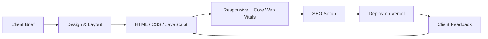
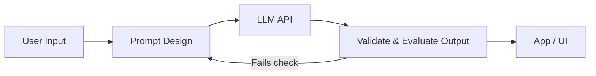

## Hi there 👋

<!--
**raja-salman-hq/raja-salman-hq** is a ✨ _special_ ✨ repository because its `README.md` (this file) appears on your GitHub profile.

Here are some ideas to get you started:

- 🔭 I’m currently working on ...
- 🌱 I’m currently learning ...
- 👯 I’m looking to collaborate on ...
- 🤔 I’m looking for help with ...
- 💬 Ask me about ...
- 📫 How to reach me: ...
- 😄 Pronouns: ...
- ⚡ Fun fact: ...
-->
<!-- 
  SETUP: replace every YOUR_USERNAME with your real GitHub username.
  This file must live in a PUBLIC repo named exactly YOUR_USERNAME/YOUR_USERNAME.
-->
<!--
<div align="center">


<a href="https://git.io/typing-svg">
  
</a>

<br/>

[](https://rajasalman-portfolio.vercel.app/)
[](https://linkedin.com/in/raja-salman-73467839a)
[](mailto:rajasalman.dev@gmail.com)


</div>

---

## 👋 About Me

I'm a **2nd-year BSCS student at NUML Rawalpindi** with a clear target: **Java backend engineer and cloud architect**.
I build real things: production websites for paying clients, database systems, and AI-powered projects, and I use hackathons to ship under pressure.

| | |
|---|---|
| 🎯 **Target** | Java Backend · Spring Boot · Spring AI · Cloud Architecture |
| 🌐 **Shipping now** | Client websites (Oasis Tree, Telnet Marketing), database systems |
| 🏆 **Hackathons** | Generative AI Hackathon · Aspire Pakistan / Pak Angels AI Hackathon |
| 📈 **Learning** | System design · AWS · Linux · Python for data/AI · n8n automation |
| 🤝 **Open to** | Internships, collaborations, and freelance web projects |

---

## 🛠️ Tech Stack

**Core (daily drivers)**


**Growing (courses done, building projects)**


**Exploring (fundamentals)**


**Digital:** SEO fundamentals · Off-page SEO · Backlinks · Core Web Vitals

---

## 🚀 Featured Projects

<table>
<tr>
<td width="50%" valign="top">

### 🏏 Cricket League Management System
Normalized (3NF) relational database for teams, players, matches and stats, with ER diagrams, SQL queries and test documentation.

`MySQL` `Database Design` `ER Modeling`

[**View Project →**](https://github.com/YOUR_USERNAME/REPO_NAME)

</td>
<td width="50%" valign="top">

### 🌳 Oasis Tree Lead Marketplace
Production single-page site for a B2B lead data marketplace. Dark green/gold UI, EmailJS contact form, WhatsApp, phone and LinkedIn integrations.

`HTML5` `CSS3` `JavaScript` `EmailJS`

[**Live Site →**](https://LIVE_URL_HERE)

</td>
</tr>
<tr>
<td width="50%" valign="top">

### 🎓 Student Learning Management System
JavaFX desktop app for student data, course enrollments and academic records, built with OOP principles.

`Java` `JavaFX` `OOP`

[**View Project →**](https://github.com/YOUR_USERNAME/REPO_NAME)

</td>
<td width="50%" valign="top">

### 📦 Inventory Management System
C++ system for products, sales and inventory, with file-based persistence and data structures.

`C++` `File I/O` `Data Structures`

[**View Project →**](https://github.com/YOUR_USERNAME/REPO_NAME)

</td>
</tr>
</table>

> 💡 Add your hackathon project here as a 5th card once the repo is public (name, one-line problem, stack, demo link).

---

## 📊 GitHub Analytics

<div align="center">


</div>

---

## 🐍 Contribution Snake

<div align="center">
<picture>
  <source media="(prefers-color-scheme: dark)" srcset="https://raw.githubusercontent.com/YOUR_USERNAME/YOUR_USERNAME/output/github-snake-dark.svg" />
  <source media="(prefers-color-scheme: light)" srcset="https://raw.githubusercontent.com/YOUR_USERNAME/YOUR_USERNAME/output/github-snake.svg" />
  
</picture>
</div>

---

## 🎯 Current Focus


---

## 💭 Developer Mindset

<div align="center">

**Think → Build → Break → Debug → Learn → Ship → Repeat** 🚀


<br/>


</div> -->

<!--
  SETUP: replace every YOUR_USERNAME with your GitHub username.
  Search for "TODO" to find every placeholder you must fill with real info.
-->
<!--
<div align="center">


<a href="https://git.io/typing-svg">
  
</a>

<br/><br/>

[](https://rajasalman-portfolio.vercel.app/)
[](https://linkedin.com/in/raja-salman-73467839a)
[](mailto:rajasalman.dev@gmail.com)


**⚡ Quick jump:**
[About](#-about-me) · [Skills](#-skills--what-i-can-actually-do) · [Python & Data](#-python-numpy--pandas) · [Web Dev](#-web-development) · [Gen AI](#-generative-ai) · [Projects](#-featured-projects) · [Roadmap](#-learning-roadmap) · [Contact](#-lets-connect)

</div>

---

## 👋 About Me

I'm a **2nd-year BSCS student at NUML Rawalpindi**, building toward **Java backend engineering and cloud architecture** (Spring Boot, Spring AI, AWS).

Alongside university I:
- ship **production websites for real clients**
- clean and validate **real business data** (Excel → structured, deduplicated, verified)
- compete in **AI hackathons** and build with LLM APIs
- study **system design, Linux and cloud deployment**

> **My rule:** *Fundamentals first, then ship, then repeat.*

| | |
|---|---|
| 🎯 **Target role** | Java Backend Developer → Cloud Architect |
| 🏆 **Hackathons** | Generative AI Hackathon · Aspire Pakistan / Pak Angels AI Hackathon · TODO add third hackathon name |
| 🌍 **Location** | Rawalpindi, Pakistan |
| 🤝 **Open to** | Internships · Freelance web projects · Collaboration |

---

## 🧭 Skills: What I Can Actually Do

Each skill shows my honest level and the proof behind it.

| Skill | Level | Proof / what I've done |
|---|---|---|
| ☕ **Java (OOP)** | 🟢 Comfortable | JavaFX Student Learning Management System |
| ⚙️ **C++** | 🟢 Comfortable | Inventory system with file handling & data structures |
| 🗄️ **SQL / MySQL / PostgreSQL** | 🟢 Comfortable | Cricket League DB, 3NF normalization, ER diagrams |
| 🌐 **HTML / CSS / JavaScript** | 🟢 Comfortable | Production client sites (Oasis Tree, Telnet Marketing) |
| 🐍 **Python** | 🟡 Practicing | Completed course, building data and AI projects |
| 🔢 **NumPy / Pandas** | 🟡 Practicing | Completed course, data cleaning and analysis |
| 🟩 **Node.js** | 🟡 Practicing | TODO add one project or exercise using it |
| 🤖 **Generative AI / LLM APIs** | 🟡 Practicing | Hackathons + LLM-based projects below |
| ☁️ **AWS / Linux / Deployment** | 🟡 Practicing | Completed courses, deploying to Vercel and cloud |
| 🔁 **n8n automation** | 🔵 Basics | TODO add one workflow you built |
| 📱 **Flutter / Kotlin (Android)** | 🔵 Basics | Fundamentals only |
| 🚀 **Spring Boot / Spring AI** | 🔴 Learning now | Main target stack |

<sub>🟢 Comfortable · 🟡 Practicing · 🔵 Basics · 🔴 Learning now</sub>


---

## 🐍 Python, NumPy & Pandas

I use these to turn **messy data into reliable data**, the same problem I solve for a B2B data marketplace (verifying records, removing duplicates, fixing missing fields).

<details>
<summary><b>📘 What I've learned (click to expand)</b></summary>

&nbsp;

**Python**
- Data types, functions, OOP, file handling, error handling
- Virtual environments, `pip`, project structure

**NumPy**
- Arrays, indexing and slicing, broadcasting
- Vectorized operations (faster than loops)
- Basic statistics and linear algebra

**Pandas**
- `DataFrame` / `Series`, filtering, `groupby`, merging
- Cleaning: missing values, duplicates, type fixes
- Reading and writing CSV and Excel

</details>

<details>
<summary><b>🧪 Example: cleaning a lead list with Pandas</b></summary>

&nbsp;

```python
import pandas as pd

df = pd.read_excel("leads_raw.xlsx")

df.columns = df.columns.str.strip().str.lower().str.replace(" ", "_")
df["email"] = df["email"].str.strip().str.lower()

df = df.drop_duplicates(subset="email")
df = df.dropna(subset=["email", "company"])

valid = df["email"].str.match(r"^[^@\s]+@[^@\s]+\.[^@\s]+$")
df_clean = df[valid]

print(f"Kept {len(df_clean)} of {len(df)} rows")
df_clean.to_csv("leads_clean.csv", index=False)
```

</details>

<details>
<summary><b>🔢 Example: why NumPy beats loops</b></summary>

&nbsp;

```python
import numpy as np

prices = np.array([120, 80, 150, 200])
tax = 0.17

with_tax = prices * (1 + tax)   # one vectorized operation, no loop
print(with_tax.round(2))
```

</details>

---

## 🌐 Web Development

I build **fast, responsive, SEO-aware websites** and deliver them to real clients.



<details>
<summary><b>🧱 Frontend & JavaScript</b></summary>

&nbsp;

- HTML5 semantic structure, CSS3 layouts (Flexbox, Grid), responsive design
- JavaScript ES6+: modules, async/await, fetch, DOM events
- Integrations: EmailJS contact forms, WhatsApp / phone / LinkedIn links

</details>

<details>
<summary><b>🟩 Node.js (backend basics)</b></summary>

&nbsp;

- Running JavaScript on the server, `npm`, modules
- Building simple REST endpoints
- Plan: use it as a stepping stone to Java Spring Boot APIs

```javascript
import http from "node:http";

http.createServer((req, res) => {
  if (req.url === "/health") {
    res.writeHead(200, { "Content-Type": "application/json" });
    return res.end(JSON.stringify({ status: "ok" }));
  }
  res.writeHead(404).end();
}).listen(3000);
``

</details>

<details>
<summary><b>📈 SEO & Performance</b></summary>

&nbsp;

- On-page SEO, off-page SEO, backlinks, PageRank basics
- Core Web Vitals (LCP, CLS, INP): image sizing, lazy loading, minimal blocking scripts

</details>

---

## 🤖 Generative AI

I build with LLM APIs and learn by shipping hackathon projects.

```mermaid
flowchart LR
    U[User Input] --> P[Prompt Design]
    P --> L[LLM API]
    L --> V[Validate & Evaluate Output]
    V --> UI[App / UI]
    V -->|Fails check| P


<details>
<summary><b>🧠 What I focus on</b></summary>

&nbsp;

- Prompt design and structured outputs
- Calling LLM APIs from Python
- Evaluating output quality instead of trusting it blindly
- Automating workflows with n8n
- Next step: **Spring AI** to bring LLMs into Java backends

</details>

<details>
<summary><b>🏆 Hackathons</b></summary>

&nbsp;

| Event | What I did |
|---|---|
| Aspire Pakistan / Pak Angels AI Hackathon | Applied AI to real-world problems in a cross-functional team, pitched under a tight deadline |
| Generative AI Hackathon | TODO: one line on your project and your role |
| TODO third hackathon | TODO: one line on your project and your role |

</details>

---

## 🚀 Featured Projects

<table>
<tr>
<td width="50%" valign="top">

### 🧠 Human Touch Quality Layer
Streamlit app that scores communications on empathy, naturalness, personalization, context-awareness and brand voice using an LLM API.

`Python` `Streamlit` `LLM API`

[**View Project →**](https://github.com/YOUR_USERNAME/TODO_REPO)

</td>
<td width="50%" valign="top">

### 🏆 TODO: Hackathon Project
One line: the problem, how you solved it, the result.

`Python` `TODO`

[**View Project →**](https://github.com/YOUR_USERNAME/TODO_REPO)

</td>
</tr>
<tr>
<td width="50%" valign="top">

### 🌳 Oasis Tree Lead Marketplace
Production single-page site for a B2B lead data marketplace with EmailJS contact form and WhatsApp, phone and LinkedIn integrations.

`HTML5` `CSS3` `JavaScript`

[**Live Site →**](https://TODO_LIVE_URL)

</td>
<td width="50%" valign="top">

### 🏏 Cricket League Management System
Relational database in 3NF with ER diagrams, SQL queries and full documentation.

`MySQL` `Database Design`

[**View Project →**](https://github.com/YOUR_USERNAME/TODO_REPO)

</td>
</tr>
<tr>
<td width="50%" valign="top">

### 🎓 Student Learning Management System
JavaFX desktop app for student data, enrollments and academic records.

`Java` `JavaFX` `OOP`

[**View Project →**](https://github.com/YOUR_USERNAME/TODO_REPO)

</td>
<td width="50%" valign="top">

### 📦 Inventory Management System
C++ system for products and sales with file-based persistence.

`C++` `File I/O`

[**View Project →**](https://github.com/YOUR_USERNAME/TODO_REPO)

</td>
</tr>
</table>

---

## 🗺️ Learning Roadmap

- [x] Java OOP, C++, SQL fundamentals
- [x] HTML, CSS, JavaScript and client website delivery
- [x] Python, NumPy, Pandas courses
- [x] AI hackathons
- [ ] Spring Boot REST API with PostgreSQL
- [ ] Spring AI integration project
- [ ] AWS: deploy a backend (EC2 / RDS / S3)
- [ ] Docker and CI/CD with GitHub Actions
- [ ] System design: caching, queues, load balancing
- [ ] Data structures and algorithms practice

---

## 📊 GitHub Analytics

<div align="center">


<picture>
  <source media="(prefers-color-scheme: dark)" srcset="https://raw.githubusercontent.com/YOUR_USERNAME/YOUR_USERNAME/output/github-snake-dark.svg" />
  <source media="(prefers-color-scheme: light)" srcset="https://raw.githubusercontent.com/YOUR_USERNAME/YOUR_USERNAME/output/github-snake.svg" />
  
</picture>

</div>

---

## 🎯 Current Focus


---

## 🌐 Let's Connect

<div align="center">

**Open to internships, freelance web projects and collaborations.**

[](https://rajasalman-portfolio.vercel.app/)
[](https://linkedin.com/in/raja-salman-73467839a)
[](mailto:rajasalman.dev@gmail.com)

**Think → Build → Break → Debug → Learn → Ship → Repeat** 🚀


</div> -->

<!--
  SETUP: replace every YOUR_USERNAME with your GitHub username.
  Search for "TODO" to find every placeholder you must fill with real info.
-->

<div align="center">

# Raja Salman

<a href="https://git.io/typing-svg">
  
</a>

<a href="https://git.io/typing-svg">
  
</a>

<br/><br/>

[](https://rajasalman-portfolio.vercel.app/)
[](https://linkedin.com/in/raja-salman-73467839a)
[](mailto:rajasalman.dev@gmail.com)

**⚡ Quick jump:**
[About](#-about-me) · [Skills](#-skills--what-i-can-actually-do) · [Python & Data](#-python-numpy--pandas) · [Web Dev](#-web-development) · [Gen AI](#-generative-ai) · [Projects](#-featured-projects) · [Roadmap](#-learning-roadmap) · [Contact](#-lets-connect)

</div>

---

## 👋 About Me

I'm a **2nd-year BSCS student at NUML Rawalpindi**, building toward **Java backend engineering and cloud architecture** (Spring Boot, Spring AI, AWS).

Alongside university I:
- ship **production websites for real clients**
- clean and validate **real business data** (Excel → structured, deduplicated, verified)
- compete in **AI hackathons** and build with LLM APIs
- study **system design, Linux and cloud deployment**

> **My rule:** *Fundamentals first, then ship, then repeat.*

| | |
|---|---|
| 🎯 **Target role** | Java Backend Developer → Cloud Architect |
| 🏆 **Hackathons** | Generative AI Hackathon · Aspire Pakistan / Pak Angels AI Hackathon · TODO add third hackathon name |
| 🌍 **Location** | Rawalpindi, Pakistan |
| 🤝 **Open to** | Internships · Freelance web projects · Collaboration |

---

## 🧭 Skills: What I Can Actually Do

Each skill shows my honest level and the proof behind it.

| Skill | Level | Proof / what I've done |
|---|---|---|
| ☕ **Java (OOP)** | 🟢 Comfortable | JavaFX Student Learning Management System |
| ⚙️ **C++** | 🟢 Comfortable | Inventory system with file handling & data structures |
| 🗄️ **SQL / MySQL / PostgreSQL** | 🟢 Comfortable | Cricket League DB, 3NF normalization, ER diagrams |
| 🌐 **HTML / CSS / JavaScript** | 🟢 Comfortable | Production client sites (Oasis Tree, Telnet Marketing) |
| 🐍 **Python** | 🟡 Practicing | Completed course, building data and AI projects |
| 🔢 **NumPy / Pandas** | 🟡 Practicing | Completed course, data cleaning and analysis |
| 🟩 **Node.js** | 🟡 Practicing | TODO add one project or exercise using it |
| 🤖 **Generative AI / LLM APIs** | 🟡 Practicing | Hackathons + LLM-based projects below |
| ☁️ **AWS / Linux / Deployment** | 🟡 Practicing | Completed courses, deploying to Vercel and cloud |
| 🔁 **n8n automation** | 🔵 Basics | TODO add one workflow you built |
| 📱 **Flutter / Kotlin (Android)** | 🔵 Basics | Fundamentals only |
| 🚀 **Spring Boot / Spring AI** | 🔴 Learning now | Main target stack |

<sub>🟢 Comfortable · 🟡 Practicing · 🔵 Basics · 🔴 Learning now</sub>

**Languages:**     

**Web & Backend:**    

**Data & AI:**   

**Cloud & Tools:**     

**Mobile (basics):**  

---

## 🐍 Python, NumPy & Pandas

I use these to turn **messy data into reliable data**, the same problem I solve for a B2B data marketplace (verifying records, removing duplicates, fixing missing fields).

<details>
<summary><b>📘 What I've learned (click to expand)</b></summary>

&nbsp;

**Python**
- Data types, functions, OOP, file handling, error handling
- Virtual environments, `pip`, project structure

**NumPy**
- Arrays, indexing and slicing, broadcasting
- Vectorized operations (faster than loops)
- Basic statistics and linear algebra

**Pandas**
- `DataFrame` / `Series`, filtering, `groupby`, merging
- Cleaning: missing values, duplicates, type fixes
- Reading and writing CSV and Excel

</details>

<details>
<summary><b>🧪 Example: cleaning a lead list with Pandas</b></summary>

&nbsp;

```python
import pandas as pd

df = pd.read_excel("leads_raw.xlsx")

df.columns = df.columns.str.strip().str.lower().str.replace(" ", "_")
df["email"] = df["email"].str.strip().str.lower()

df = df.drop_duplicates(subset="email")
df = df.dropna(subset=["email", "company"])

valid = df["email"].str.match(r"^[^@\s]+@[^@\s]+\.[^@\s]+$")
df_clean = df[valid]

print(f"Kept {len(df_clean)} of {len(df)} rows")
df_clean.to_csv("leads_clean.csv", index=False)
```

</details>

<details>
<summary><b>🔢 Example: why NumPy beats loops</b></summary>

&nbsp;

```python
import numpy as np

prices = np.array([120, 80, 150, 200])
tax = 0.17

with_tax = prices * (1 + tax)   # one vectorized operation, no loop
print(with_tax.round(2))
```

</details>

---

## 🌐 Web Development

I build **fast, responsive, SEO-aware websites** and deliver them to real clients.


<details>
<summary><b>🧱 Frontend & JavaScript</b></summary>

&nbsp;

- HTML5 semantic structure, CSS3 layouts (Flexbox, Grid), responsive design
- JavaScript ES6+: modules, async/await, fetch, DOM events
- Integrations: EmailJS contact forms, WhatsApp / phone / LinkedIn links

</details>

<details>
<summary><b>🟩 Node.js (backend basics)</b></summary>

&nbsp;

- Running JavaScript on the server, `npm`, modules
- Building simple REST endpoints
- Plan: use it as a stepping stone to Java Spring Boot APIs

```javascript
import http from "node:http";

http.createServer((req, res) => {
  if (req.url === "/health") {
    res.writeHead(200, { "Content-Type": "application/json" });
    return res.end(JSON.stringify({ status: "ok" }));
  }
  res.writeHead(404).end();
}).listen(3000);
```

</details>

<details>
<summary><b>📈 SEO & Performance</b></summary>

&nbsp;

- On-page SEO, off-page SEO, backlinks, PageRank basics
- Core Web Vitals (LCP, CLS, INP): image sizing, lazy loading, minimal blocking scripts

</details>

---

## 🤖 Generative AI

I build with LLM APIs and learn by shipping hackathon projects.



<details>
<summary><b>🧠 What I focus on</b></summary>

&nbsp;

- Prompt design and structured outputs
- Calling LLM APIs from Python
- Evaluating output quality instead of trusting it blindly
- Automating workflows with n8n
- Next step: **Spring AI** to bring LLMs into Java backends

</details>

<details>
<summary><b>🏆 Hackathons</b></summary>

&nbsp;

| Event | What I did |
|---|---|
| Aspire Pakistan / Pak Angels AI Hackathon | Applied AI to real-world problems in a cross-functional team, pitched under a tight deadline |
| Generative AI Hackathon | TODO: one line on your project and your role |
| TODO third hackathon | TODO: one line on your project and your role |

</details>

---

## 🚀 Featured Projects

<table>
<tr>
<td width="50%" valign="top">

### 🧠 Human Touch Quality Layer
Streamlit app that scores communications on empathy, naturalness, personalization, context-awareness and brand voice using an LLM API.

`Python` `Streamlit` `LLM API`

[**View Project →**](https://github.com/YOUR_USERNAME/TODO_REPO)

</td>
<td width="50%" valign="top">

### 🏆 TODO: Hackathon Project
One line: the problem, how you solved it, the result.

`Python` `TODO`

[**View Project →**](https://github.com/YOUR_USERNAME/TODO_REPO)

</td>
</tr>
<tr>
<td width="50%" valign="top">

### 🌳 Oasis Tree Lead Marketplace
Production single-page site for a B2B lead data marketplace with EmailJS contact form and WhatsApp, phone and LinkedIn integrations.

`HTML5` `CSS3` `JavaScript`

[**Live Site →**](https://TODO_LIVE_URL)

</td>
<td width="50%" valign="top">

### 🏏 Cricket League Management System
Relational database in 3NF with ER diagrams, SQL queries and full documentation.

`MySQL` `Database Design`

[**View Project →**](https://github.com/YOUR_USERNAME/TODO_REPO)

</td>
</tr>
<tr>
<td width="50%" valign="top">

### 🎓 Student Learning Management System
JavaFX desktop app for student data, enrollments and academic records.

`Java` `JavaFX` `OOP`

[**View Project →**](https://github.com/YOUR_USERNAME/TODO_REPO)

</td>
<td width="50%" valign="top">

### 📦 Inventory Management System
C++ system for products and sales with file-based persistence.

`C++` `File I/O`

[**View Project →**](https://github.com/YOUR_USERNAME/TODO_REPO)

</td>
</tr>
</table>

---

## 🗺️ Learning Roadmap

- [x] Java OOP, C++, SQL fundamentals
- [x] HTML, CSS, JavaScript and client website delivery
- [x] Python, NumPy, Pandas courses
- [x] AI hackathons
- [ ] Spring Boot REST API with PostgreSQL
- [ ] Spring AI integration project
- [ ] AWS: deploy a backend (EC2 / RDS / S3)
- [ ] Docker and CI/CD with GitHub Actions
- [ ] System design: caching, queues, load balancing
- [ ] Data structures and algorithms practice

---

## 🎯 Current Focus


---

## 🌐 Let's Connect

<div align="center">

**Open to internships, freelance web projects and collaborations.**

[](https://rajasalman-portfolio.vercel.app/)
[](https://linkedin.com/in/raja-salman-73467839a)
[](mailto:rajasalman.dev@gmail.com)

**Think → Build → Break → Debug → Learn → Ship → Repeat** 🚀


</div>
